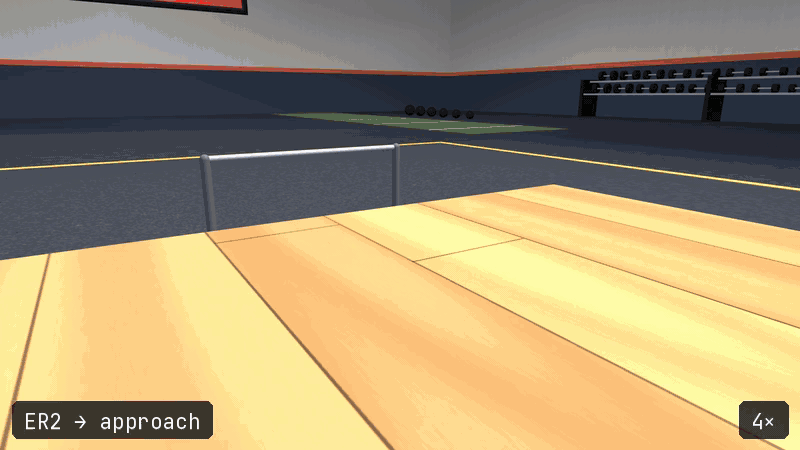
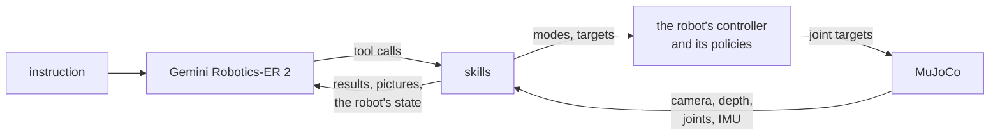
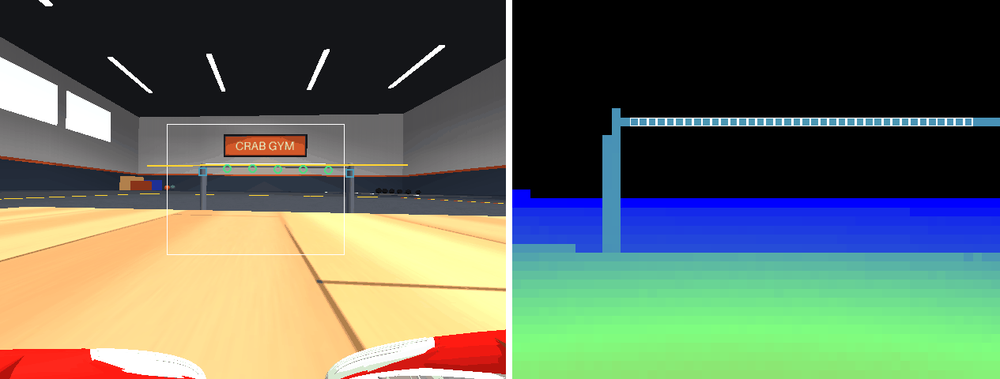

# Jumper Gym

**English** | [简体中文](README.zh.md)

**Gemini Robotics-ER 2 directs a six-legged crab robot through pull-ups, in simulation.** It
sees what the robot sees -- its colour camera and its depth sensor -- and nothing else, and
decides every step itself: where to look, where the bar is, where to walk, when the claws
hold. Policies trained with reinforcement learning move the legs and the arms.



<sub>One run of 2026-10-15, from the walk in to the third pull-up. The label is the call ER2
made and the corner the speed; the time between actions is cut. Rendered from a replay of
the run: its recorded calls made again in the simulator, which went the same way.</sub>

This repository is a fork of [Jumper](https://github.com/KingKongRobotics/jumper), KingKong
Robotics' toolkit for designing, training and deploying the robot. It adds the gym, two
motions trained for it, and what the robot's controller needed for them.

## How a run goes

The robot is set down somewhere on a raised deck, facing anywhere. ER2 is given the
instruction -- `做 3 个引体向上`, or `Do three pull-ups` -- and the station's measured
dimensions, and is not told the order to do things in. In a run that succeeds it turns the
robot until the bar is in view, points at the bar in the pictures, walks in on six legs,
gets up on four with the arms raised, walks to the deck's edge, reaches the claws onto the
bar, checks the grasp, grips, swings under the bar and pulls up. Each step is a tool it
calls, and a tool that cannot do what it is asked says why. The run ends when ER2 calls
`finish` with its own count; an evaluator then scores it against the simulator's truth,
which neither ER2 nor the skills can read.





<sub>What ER2 was shown 1.16 m from the bar. Left, the robot's colour camera: ER2's points
along the bar (green), where it said the bar meets each post (blue), the bar as measured
(yellow) and the depth sensor's window (white). Right, the depth sensor's own picture, near
red to far blue, with the zones read on the bar outlined.</sub>

An earlier version told ER2 the way through: ten phases in order, with the numbers each
needed. ER2 followed it to the letter -- the two runs that did the pull-ups on 2026-10-11
made the same 46 calls in the same order. Without the recipe the success held, 7 of 10
against 7 and 6, and the runs got shorter and cheaper: a median 0.62M prompt tokens a run
against 0.92M and 0.83M.

## Results

Ten scenarios on 2026-10-14, with Gemini Robotics-ER 2 preview: random spawns, a corner
facing away, in front of a post, half a metre from the deck's edge, two pull-ups and then
off the bar, and one that asked only to stand in front of the bar; five of the ten
instructions were in English. The runs used `--realtime` on the plain map, eight at once on
an RTX 5070 machine.

| | |
|---|---|
| succeeded | 7 of 10 |
| robot's time | median 48 s (35 to 95 s) |
| waiting on ER2 | median 51 s more |
| prompt tokens | median 0.62M a run |

Eight of the nine runs asked for pull-ups did them all and counted them right. Two of those
eight let go of the bar afterwards, unasked, and fell landing; the ninth fell off the deck's
edge walking in on four legs. These and the other problems the records show are listed
under [What it did](docs/CRABGYM.md#what-it-did).

## Run it

Linux x86-64 with glibc 2.34 or newer (Ubuntu 22.04 and later), and Python 3.10 to 3.13. The
robot's controller built for this platform and the four policies come in
`out/bundle_gym/gym.app`.

```bash
git clone -b crabgym https://github.com/Houserz/jumper-gym.git && cd jumper-gym
python3 -m venv .venv && source .venv/bin/activate
pip install -e ".[dev]"
echo 'GOOGLE_API_KEY=...' > .env.local    # a key that can call gemini-robotics-er-2-preview
MUJOCO_GL=egl python -m crabgym "做 3 个引体向上" --agent gemini --viewer
```

`--viewer` opens MuJoCo's window, with the robot's camera and depth sensor in its corners;
leave it out on a machine without a display. In another terminal, `python -m crabgym.web`
shows ER2's conversation as it goes, at http://127.0.0.1:8765. Without `--agent gemini` an
emulator stands in for ER2 and no key is needed. A run's record lands in
`logs/crabgym/<timestamp>/`. The simulation runs about ten times slower than real time: a run
of the emulator took 460 s for 46.8 s of the robot's time, alone on the RTX 5070 machine.
[docs/CRABGYM.md](docs/CRABGYM.md) has the options, what a run writes and how each part
works.

## What this fork adds

| | |
|---|---|
| [`crabgym/`](crabgym) | The gym: ER2's loop and tools, the skills, perception on the robot's own camera and depth sensor, odometry on its feet, the evaluator and the console |
| [`tasks/jumper/quad_walk/`](tasks/jumper/quad_walk) | Standing and a slow walk on four legs, the front arms raised |
| [`tasks/jumper/pull_up/`](tasks/jumper/pull_up) | Pull-ups from the hang, on the station's rig (`scenes/bar.py`) |
| [`crabgym/maps/`](crabgym/maps) | The station: a deck 0.22 m high, the bar 0.27 m above it and 0.11 m past its edge, a pit under the bar |
| [`out/bundle_gym/`](out/bundle_gym) | The bundle the gym runs: the controller for Linux x86-64 and four policies |
| [`deploy/fsm/`](deploy/fsm) | The controller, on every host: states that follow joint targets the host streams, a mode's undriven joints streamed from the host, mode switches the host requests (`request:<state>`), and `jumper.pull_up`'s command |
| [`docs/CRABGYM.md`](docs/CRABGYM.md) | How a run goes, how to run it, what it did, known problems |

## Built on Jumper

Jumper is KingKong Robotics' 22-DoF crab robot ([hardware](docs/HARDWARE.md)).
[Its repository](https://github.com/KingKongRobotics/jumper) is the toolkit for designing its
appearance and scenes, training its motions and putting them on the robot, and all of it is
here too:

| | |
|---|---|
| [jumper-design](https://github.com/KingKongRobotics/jumper-design) | Appearance and scene creation |
| [Training tutorial](docs/TUTORIAL.md) | Motion training, replay and policy export |
| [Colab training](docs/COLAB.md) | GPU training in a notebook |
| [Motion bundles](deploy/BUNDLE.md) | Trained motions and their controller packaged as an `.app`; the [build guide](deploy/README.md) |
| [Project guide](docs/PROJECT_GUIDE.md) | Setup, capabilities and the rest of the documentation |

Training builds on [mjlab](https://github.com/mujocolab/mjlab),
[rsl_rl](https://github.com/leggedrobotics/rsl_rl), [MuJoCo](https://github.com/google-deepmind/mujoco)
and [MuJoCo Warp](https://github.com/google-deepmind/mujoco_warp). Where the pictures in
`docs/media/` come from is recorded beside them.

## License

Jumper is copyright 2026 KingKong Robotics, and this fork's changes are copyright 2026
Houserz. Maintainer-owned project materials are licensed under Apache-2.0: see
[LICENSE](LICENSE), [NOTICE](NOTICE) -- which also says what this fork changed -- and the
[licensing details](docs/PROJECT_GUIDE.md#license). Third-party materials remain under their
respective terms, and generated outputs do not automatically inherit this repository's
license.
