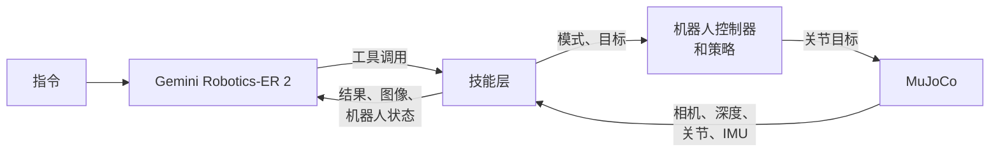

<!-- tracks: README.md @ sha256:3897d69bae96ab96 -->

# Jumper Gym

[English](README.md) | **简体中文**

**Gemini Robotics-ER 2 在仿真里指挥一台六足螃蟹机器人做引体向上。** 它能看到的只有机器人自己的彩色相机和深度传感器，每一步都由它自己决定：看哪里、杆在哪里、往哪里走、爪子是否抓牢。腿和手臂的动作由强化学习训练的策略执行。


<sub>2026-10-16 的一次运行，从走近单杠到落地：三个引体向上之后，ER2 在没人要求的情况下下了杠。左下角是 ER2 调用的工具，右下角是播放倍速，动作之间的空档已剪掉。画面渲染自运行时记录下的仿真状态。</sub>

本仓库 fork 自 [Jumper](https://github.com/KingKongRobotics/jumper)，即 KingKong Robotics 设计、训练和部署这台机器人的工具集。在此基础上，本仓库加入了螃蟹健身房、为它训练的两个动作，以及机器人控制器为此所需的改动。

## 一次运行的过程

机器人被放在高台上的任意位置，朝向也是任意的。ER2 收到指令（`做 3 个引体向上` 或 `Do three pull-ups`）和引体向上台的实测尺寸，没有人告诉它先做什么、后做什么。在一次成功的运行里，它先转动机器人直到看见单杠，在画面里标出单杠，用六条腿走近，再用四条腿站起、抬起前臂，走到高台边缘，把爪子伸到杠上，检查抓握，合拢爪子，荡到杠下，然后做引体向上。每一步都是它调用的一个工具，工具遇到做不到的事会拒绝，并说明原因。ER2 调用 `finish` 并报出自己数的次数，运行就此结束。随后评估器对照仿真器的真值打分，这个真值 ER2 和技能层都读不到。




<sub>ER2 在离单杠 1.16 m 处看到的画面。左图是机器人的彩色相机：ER2 沿杆标的点（绿），它认定的杆与立柱的交点（蓝），测出的杆（黄），深度传感器的视野（白框）。右图是深度传感器自己的图像，由近到远从红到蓝，落在杆上的测区用白框标出。</sub>

早先的版本把做法直接告诉 ER2：按顺序列出十个阶段，以及每个阶段要用的数字。ER2 照做不误，2026-10-11 完成引体向上的两次运行，调用了同样的 46 次工具，顺序也完全一样。去掉这份做法后，成功率没有下降，10 次成功 7 次，有做法时是 7 次和 6 次；运行也更短、更省，每次运行的提示 token 中位数是 0.62M，有做法时是 0.92M 和 0.83M。

## 结果

2026-10-14 用 Gemini Robotics-ER 2 preview 跑了十个场景：随机出生点、角落里背对单杠、正对立柱、离高台边缘半米、做两个引体向上后下杠，以及只要求站到单杠前面；十条指令里有五条是英文。这些运行都开了 `--realtime`，用的是原始地图（`--look plain`），在一台 RTX 5070 机器上八个并行。

| | |
|---|---|
| 成功 | 10 次中 7 次 |
| 机器人用时 | 中位数 48 s（35 到 95 s） |
| 等待 ER2 | 中位数另加 51 s |
| 提示 token | 每次运行中位数 0.62M |

要求做引体向上的九次运行里，八次全部做完，计数也正确。这八次里有两次，做完后未经要求就松开了单杠，落地时摔倒；第九次用四条腿走向高台边缘时掉了下去。这些问题和记录里能看到的其他问题，列在 [What it did](docs/CRABGYM.md#what-it-did) 一节。

## 运行

需要 Linux x86-64（glibc 2.34 或更新，即 Ubuntu 22.04 及以后）和 Python 3.10 到 3.13。为这个平台编译的机器人控制器和四个策略都在 `out/bundle_gym/gym.app` 里。

```bash
git clone -b crabgym https://github.com/Houserz/jumper-gym.git && cd jumper-gym
python3 -m venv .venv && source .venv/bin/activate
pip install -e ".[dev]"
echo 'GOOGLE_API_KEY=...' > .env.local    # 要能调用 gemini-robotics-er-2-preview 的 key
MUJOCO_GL=egl python -m crabgym "做 3 个引体向上" --agent gemini --viewer
```

`--viewer` 会打开 MuJoCo 窗口，两个角上是机器人的相机和深度传感器的画面；没有显示器的机器上去掉这个选项。在另一个终端运行 `python -m crabgym.web`，会在 http://127.0.0.1:8765 实时显示 ER2 的对话。不加 `--agent gemini` 时，由一个模拟 ER2 的程序（emulator）代替它，不需要 key。每次运行的记录都在 `logs/crabgym/<timestamp>/`。仿真比真实时间慢约十倍：在那台 RTX 5070 机器上单独跑 emulator，机器人的 46.8 s 用了 460 s。[docs/CRABGYM.md](docs/CRABGYM.md) 里有全部选项、运行记录的内容和各部分的工作方式。

## 本 fork 新增的内容

| | |
|---|---|
| [`crabgym/`](crabgym) | 螃蟹健身房本身：ER2 的主循环和工具、技能层、基于机器人自身相机和深度传感器的感知、基于足端的里程计、评估器和网页控制台 |
| [`tasks/jumper/quad_walk/`](tasks/jumper/quad_walk) | 四足站立和慢走，前臂抬起 |
| [`tasks/jumper/pull_up/`](tasks/jumper/pull_up) | 从悬挂开始做引体向上，训练场景与引体向上台一致（`scenes/bar.py`） |
| [`crabgym/maps/`](crabgym/maps) | 引体向上台：高台高 0.22 m，单杠比台面高 0.27 m、伸出台边 0.11 m，杠下是坑 |
| [`out/bundle_gym/`](out/bundle_gym) | 健身房运行的 bundle：Linux x86-64 版控制器和四个策略 |
| [`deploy/fsm/`](deploy/fsm) | 各宿主共用的控制器：跟随宿主流式发送的关节目标的状态，由宿主流式发送某个模式的策略不驱动的关节，由宿主请求的模式切换（`request:<state>`），以及 `jumper.pull_up` 的指令 |
| [`docs/CRABGYM.md`](docs/CRABGYM.md) | 运行过程、运行方法、实测结果和已知问题 |

## 基于跳跳（Jumper）

跳跳（Jumper）是 KingKong Robotics 的 22 自由度螃蟹机器人（[硬件](docs/HARDWARE.zh.md)）。[它的仓库](https://github.com/KingKongRobotics/jumper)是设计外观和场景、训练动作并部署到机器人上的工具集，这些内容本仓库都保留着：

| | |
|---|---|
| [jumper-design](https://github.com/KingKongRobotics/jumper-design) | 外观与场景生成 |
| [训练教程](docs/TUTORIAL.zh.md) | 动作训练、回放与策略导出 |
| [Colab 训练](docs/COLAB.zh.md) | 在 Notebook 中用 GPU 训练 |
| [动作包格式](deploy/BUNDLE.md) | 将训练好的动作及控制器打包为 `.app`；见[构建指南](deploy/README.zh.md) |
| [项目指南](docs/PROJECT_GUIDE.zh.md) | 环境安装、当前能力和其余文档 |

训练基于 [mjlab](https://github.com/mujocolab/mjlab)、[rsl_rl](https://github.com/leggedrobotics/rsl_rl)、[MuJoCo](https://github.com/google-deepmind/mujoco) 和 [MuJoCo Warp](https://github.com/google-deepmind/mujoco_warp)。`docs/media/` 里各张图片的来源记录在同一目录下。

## 许可证

跳跳的版权归 KingKong Robotics 所有（2026），本 fork 的改动版权归 Houserz 所有（2026）。维护者拥有权利的项目内容采用 Apache-2.0，详见 [LICENSE](LICENSE)、[NOTICE](NOTICE)（其中也写明了本 fork 的改动）和[许可说明](docs/PROJECT_GUIDE.zh.md#许可证)。第三方内容保留其各自的许可条款；使用本工具生成的文件不会自动继承本仓库许可证。
